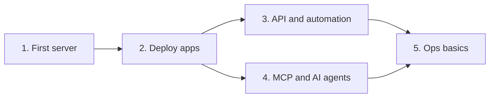

<h1 align="center">Cloudways Cookbook</h1>

<p align="center"><b>Launch, deploy, and automate on Cloudways in an afternoon.</b><br>
A hands-on guide for hackers: Git deploys, the v2 API, and AI-agent control over MCP.</p>

<p align="center">
  
  
  
  
</p>


A hands-on collection of guides and runnable examples for hackers getting started with [Cloudways](https://www.cloudways.com): managed cloud hosting on top of DigitalOcean, Vultr, Linode, AWS, and Google Cloud.

> **Disclaimer:** This is an unofficial, community-style guide, fact-checked against Cloudways docs on **October 21, 2026**. Cloudways ships changes often (the API, MCP server, and auth model all changed in 2026). Always confirm details in the [official docs](https://support.cloudways.com) and the [API Playground](https://developers.cloudways.com/play). Anything marked **(verify)** was read from docs but not tested against a live account.

## Who this is for

Developers who are comfortable with a terminal and Git but new to Cloudways. You'll go from zero to a deployed app, then automate it with the API and drive it from an AI agent over MCP.

## Learning path



## Repository structure

- `**Tutorials**`: Step-by-step guides, numbered in the order to read them.
- `**Scripts**`: Dependency-free Python helpers for the Cloudways API (`cw.py` plus small CLI tools).
- `**Notebooks**`: A Jupyter quickstart for exploring the API interactively.
- `**GUIDE.md**`: Everything above in one long file.
- `**site/index.html**`: The same guide as a polished, self-contained web page (dark mode, copy buttons). This is what gets deployed.
- `**.do/app.yaml**`: DigitalOcean App Platform spec for hosting the page.
- `**tools/build.py**`: Regenerates `GUIDE.md` and `site/index.html` from the tutorials.

## Get started

| # | Tutorial | You will |
|---|----------|----------|
| 1 | `First server and app` | Start the free trial, launch a server, reach it over SSH/SFTP |
| 2 | `Deploy apps` | Ship WordPress, PHP/Laravel, and Git-based deployments |
| 3 | `API and automation` | Create an Access Token, call the v2 API, script your fleet |
| 4 | `MCP and AI agents` | Manage Cloudways from Claude, Cursor, VS Code, and more |
| 5 | `Ops basics` | Domains, SSL, backups, staging, monitoring, scaling |

**Fastest path for a hackathon:** do tutorial 1, then tutorial 3 or 4. You can have a server provisioned and scripted in well under an hour, minus provisioning wait time.

## Before you begin: three things that changed in 2026

1. **Legacy API keys are going away.** The email + API key flow was scheduled for end of life on **October 15, 2026** (already passed), after which keys are revoked. New accounts only get **Access Tokens**. Use `Authorization: Bearer <token>`.
2. **API v1 is sunset, v2 is current.** The v2 base URL is `https://api.cloudways.com/api/v2`. Cloudways says migration is mostly replacing `v1` with `v2` in URL paths. Some older help articles still show v1 code samples.
3. **API access is owner-only.** Team members can't create tokens; the primary account owner must.

## Quick API smoke test

```bash
export CLOUDWAYS_TOKEN="<your access token>"
python3 scripts/list_servers.py
```

## Additional resources

- [Cloudways Help Center](https://support.cloudways.com)
- [API docs](https://developers.cloudways.com/docs) and [API Playground](https://developers.cloudways.com/play)
- [Access Token guide](https://support.cloudways.com/en/articles/5136065-how-to-create-and-manage-cloudways-api-access-tokens)
- [MCP server setup](https://support.cloudways.com/en/articles/14654372-how-to-use-cloudways-mcp-server-for-ai-based-server-management) and [MCP tool reference](https://support.cloudways.com/en/articles/15798823-cloudways-mcp-server-tools)
- [Node.js templates on GitHub](https://github.com/CloudwaysbyDO/)
- [Cloudways on Reddit](https://www.reddit.com/r/CloudwaysbyDO/)

## Get help

Ask in the Cloudways community, or contact support 24/7 through the platform's chat. For issues with this cookbook, open an issue in this repository.

## Contributing

Corrections are welcome, especially anything marked **(verify)** that you've confirmed. Keep examples runnable and keep secrets out of commits. After editing a tutorial, run `pip install markdown && python3 tools/build.py` to refresh `GUIDE.md` and `site/index.html`.

## Host it on DigitalOcean

The guide is a static page, so it fits App Platform's static-site component. DigitalOcean's [free tier](https://docs.digitalocean.com/products/app-platform/details/pricing/#free-tier) covers up to three apps made only of static sites, with 1 GiB of outbound data per app (extra transfer is $0.02 per GiB). Check the pricing page for current terms.

1. Push this repo to GitHub.
2. In `.do/app.yaml`, replace `YOUR_GITHUB_USER` with your GitHub username.
3. Open the [Apps page](https://cloud.digitalocean.com/apps), click **Create App**, choose **GitHub**, and select this repo and the `main` branch. Set the source directory to `/site`.
4. Confirm the component type is **Static Site**, review the plan summary (it should show the free tier), and launch.

Or from the terminal, with [`doctl`](https://docs.digitalocean.com/reference/doctl/how-to/install/) authenticated and GitHub connected to your DigitalOcean account:

```bash
doctl apps create --spec .do/app.yaml
```

Pushes to `main` redeploy automatically. Run `python3 tools/build.py` and commit `site/index.html` after editing tutorials. To use your own domain, add it under the app's **Settings → Domains**.

## Safety notes for hackers

- Servers bill by the hour once you leave the trial. Delete what you don't need.
- The API Playground and every script here act on your **real account**. Use a throwaway server.
- Never commit tokens. Use environment variables or a secrets manager.


---

# 1. Your first server and app

**Goal:** a running Cloudways server with one app, reachable over SSH and SFTP.

## Concepts in 60 seconds

- **Server**: a VM on a cloud provider (DigitalOcean, Vultr, Linode, AWS, or Google Cloud) that Cloudways provisions and manages.
- **Application**: a site or app on a server (WordPress, WooCommerce, Laravel, Magento, PHP, and others). One server can host many apps.
- **Project**: an optional grouping of servers and apps.
- **Credentials**: *master* credentials reach every app on the server; *application* credentials reach one app.

## Step 1: Start the free trial

Cloudways offers a **3-day Flexible trial with no credit card**. To keep your server afterward you must add a card (a small temporary verification charge, reversed automatically, may appear).

**Hackathon paths:** sign up with the shared promo code. Without a card you can trial Flexible/Autonomous on a 2 GB or 4 GB server, or Velocity Starter (2 GB). Add a card if you want the **$20 credits**.

1. Sign up at [platform.cloudways.com](https://platform.cloudways.com/signup) and log in.
2. In the left menu choose **Cloudways Flexible**, then **Get Started**, then **3-days free trial**.
3. Pick your app, server, and project names.
4. Choose a provider, server size (2 GB or 4 GB for the no-card trial), and location.
5. Click **Launch Now**.

> **Hackathon tip:** DigitalOcean at 2 GB is a solid default for the no-card trial. Pick the region closest to your judges or users.

Provisioning takes a few minutes. The dashboard shows progress.

## Step 2: Find your credentials

Menu labels shift over time, so look for the equivalents if yours differ. Open **Servers → your server → Master Credentials** for the public IP, master username, and password. For a single app, open **Applications → your app → Access Details**.

## Step 3: Enable SSH for the app

SSH is **not enabled by default** for application users. Open the app's **Application Settings** and toggle **Enable SSH Access**. Master credentials work without this.

## Step 4: Connect

```bash
ssh <username>@<server-ip>
```

For SFTP use the same host, user, and password with any client (`sftp`, Cyberduck, FileZilla).

**Prefer keys:** add your public key under the server's SSH key settings so you can skip passwords. (You can also do this by API or MCP; see tutorials 3 and 4.)

## Step 5: Look around

```bash
cd ~/applications        # one folder per app, named by an internal ID
ls
cd <app-folder>/public_html
```

`public_html` is the web root. Edit a file, refresh the app URL, and you've confirmed the full loop.

## Checkpoint

- [ ] Server shows **Running**
- [ ] You can SSH or SFTP in
- [ ] You know your server ID and app ID (visible in the dashboard URL and in `scripts/list_servers.py` output)

**Next:** `Deploy apps →`

## References

- [Flexible trial guide](https://support.cloudways.com/en/articles/10061830-how-to-subscribe-flexible-trial)


---

# 2. Deploy apps

**Goal:** get real code running on your server three ways: a one-click app, a Git deployment, and a PHP/Laravel app.

## A. One-click apps (WordPress and friends)

When you launch a server (or later, **Add Application** on an existing server), choose an application type. Cloudways installs and configures it. Supported types include WordPress, WooCommerce, Laravel, Magento, and PHP, among others.

After install, the app has a default Cloudways URL. Use it right away; add your own domain in `tutorial 5`.

## B. Git deployment

Cloudways can pull code from your repo into an app. Know these up front:

- The repo must be reachable **over SSH** (HTTPS URLs are not supported).
- You add a Cloudways-generated **deploy key** to your repo host.
- The keys generated in the Cloudways UI work for **console deployments only**. To run `git` yourself on the server (push, checkout, etc.) you need **master credentials** and your own key pair.

**Manual deploys (console)**

1. Open **Applications → your app → Deployment via Git**.
2. Click **Generate SSH Key** and copy the public key.
3. In GitHub: repo **Settings → Deploy keys → Add deploy key**, paste, save. (GitLab and Bitbucket have equivalents.)
4. Back in Cloudways, enter the SSH repo address (`git@github.com:you/repo.git`), then **Get Branches**.
5. Choose a branch and deploy path (empty means `public_html`), then **Start Deployment**.
6. For later updates, click **Pull**.

**Auto-deploy on push**

Cloudways documents this as a small webhook script *you* host, which calls the Git API. Prerequisites: you are the primary account owner, the app is on a Flexible server, and manual Git deployment already works. In short:

1. Create an Access Token with **Limited Access**, only the Git pull operation.
2. Put the token, server ID, app ID, SSH Git URL, and branch in a config file **outside** `public_html`, and keep it out of Git.
3. Add a small PHP endpoint that accepts **POST only**, checks a long random webhook secret, and calls the Git pull API.
4. Add the endpoint URL as a push webhook in GitHub or Bitbucket.

Cloudways' [step-by-step webhook guide](https://support.cloudways.com/en/articles/5124785-automatically-deploy-from-git-to-server-using-webhooks) includes the full hardened script. Its sample code still shows the v1 base URL; use v2 (see tutorial 3).

You can also trigger a pull from your own CI with `scripts/git_deploy.py`. The pull call takes the server ID, app ID, SSH Git URL, and branch name (deploy path optional).

## C. A Laravel or custom PHP app

1. Create a **Laravel** (or **PHP**) application.
2. Deploy your code with Git as above, or upload via SFTP.
3. Laravel serves from `public/`. Point the app's **webroot** at it (Application Settings → webroot, or the `app_webroot_update` MCP tool): `/public_html/public`.
4. SSH in and run your build steps:

```bash
cd ~/applications/<app-folder>/public_html
composer install --no-dev
cp .env.example .env && php artisan key:generate
php artisan migrate --force
```

Get the database host, name, user, and password from **Application → Access Details**.

## D. Node.js with Cloudways Velocity

**Cloudways Velocity** is managed Node.js hosting, now **Generally Available**. Per the [Velocity page](https://www.cloudways.com/en/velocity.php) (checked Oct 28, 2026):

- Connect a GitHub, GitLab, or Bitbucket repo; Velocity detects the framework and sets build and start commands.
- Presets for Next.js, Remix, React, Astro, Nuxt, Svelte, Vite, Express, Fastify, Angular, and n8n. Node.js LTS 22.x and 24.x, selectable per app.
- PostgreSQL can be provisioned from the dashboard.
- Flat monthly plans on persistent servers (no cold starts), starting at $20/month; Starter (2 GB) and Professional (4 GB) include a 3-day free trial.

Starter templates live at [github.com/CloudwaysbyDO](https://github.com/CloudwaysbyDO/). Velocity is separate from the Flexible (PHP-centric) servers used in the other sections.

## Troubleshooting

| Symptom | Likely cause |
|---|---|
| Git "permission denied" | Deploy key not added to the repo, or you used an HTTPS URL |
| `git` works in the console but not over SSH | UI-generated keys only work for console deploys; use master credentials and your own key |
| 403 / blank page on Laravel | Webroot not set to `public` |
| `ssh: permission denied` for an app user | SSH not enabled in Application Settings |
| Files owned by wrong user after manual edits | Use **Reset File Permissions** |

**Next:** `API and automation →`

## References

- [Git deployment help article](https://support.cloudways.com/using-git-for-deployment/)
- [Using Git via the command line](https://support.cloudways.com/en/articles/5124793-using-git-via-command-line)
- [Auto-deploy with webhooks](https://support.cloudways.com/en/articles/5124785-automatically-deploy-from-git-to-server-using-webhooks)
- [Cloudways Velocity](https://www.cloudways.com/en/velocity.php)


---

# 3. API and automation

**Goal:** authenticate with an Access Token and script your Cloudways account.

## The 2026 auth model

- **Legacy email + API key (`/oauth/access_token`)**: scheduled end of life October 15, 2026 (passed); keys are revoked afterward. Cloudways says not to build new integrations on it.
- **Access Tokens**: create many, each with a name, expiry, and scope. Send as `Authorization: Bearer <token>`.
- **API v2** is current; v1 is sunset. Cloudways' migration note: replace `v1` with `v2` in URL paths.
- **Rate limit:** 100 requests per minute (per Cloudways' API article).
- Only the **primary account owner** can create tokens.

## Step 1: Create a token

1. Log in at [unified.cloudways.com](https://unified.cloudways.com).
2. Top-right profile menu → **API Integration** → **Create Access Token**.
3. Name it (e.g. `hackathon-dev`), pick a short expiry (**1 day** is plenty for a hackathon), and choose a scope:
   - **Read-Only**: GET calls only. Start here.
   - **Limited Access** (beta): pick endpoint groups (Server, Application, Git, Lists, Monitoring, ...).
   - **Full Access**: everything. Avoid unless needed.
4. Copy the token immediately. **It's shown once** and can't be recovered.

```bash
export CLOUDWAYS_TOKEN="<paste here>"   # never commit this
```

## Step 2: Try the Playground

Open the [API Playground](https://developers.cloudways.com/play), click **Authorize**, choose the **Access Token** tab, paste your token. Run `GET /server` (list servers). The Playground shows request and response shapes for every endpoint. It acts on your **real account**, so test on a throwaway server.

## Step 3: Call it from code

Base URL (confirmed by Cloudways' MCP 2.0 announcement, which lists `https://api.cloudways.com/api/v2/providers`):

```
https://api.cloudways.com/api/v2
```

Override with `CLOUDWAYS_API_BASE` if it ever changes. Note: some help articles (e.g. the Git webhook guide) still show `/api/v1` in sample code; that's stale.

```bash
curl -s -H "Authorization: Bearer $CLOUDWAYS_TOKEN" \
  https://api.cloudways.com/api/v2/server | head -c 600

# reference data (providers, regions, sizes) lives under the Lists endpoints:
curl -s -H "Authorization: Bearer $CLOUDWAYS_TOKEN" \
  https://api.cloudways.com/api/v2/providers | head -c 600
```

Or use the helper scripts (standard library only, Python 3.8+):

| Script | What it does |
|---|---|
| `scripts/cw.py` | Tiny client: auth, errors, and operation polling |
| `scripts/list_servers.py` | List servers and their apps (read-only) |
| `scripts/create_server.py` | Launch a server. **Dry run by default**; needs `--yes` to spend money |
| `scripts/git_deploy.py` | Clone or pull a Git repo into an app |
| `scripts/app_backup.py` | Back up an app before you deploy |

```bash
python3 scripts/list_servers.py
python3 scripts/create_server.py --provider do --region nyc3 --size 1GB --app wordpress
python3 scripts/git_deploy.py pull --server 123 --app 456 --url git@github.com:me/repo.git --branch main
```

## Things to know

- **Creation is asynchronous.** `POST /server` returns an operation ID; poll the operation endpoint until it completes. `cw.wait_for_operation()` does this.
- **Provider matters.** Valid regions, sizes, and options differ per provider; wrong combinations return `422`. Discover valid values from the **Lists** endpoints (providers, regions, sizes, apps) rather than guessing.
- **Request bodies for `POST /server` and backups are marked (verify).** Check each against the Playground's request schema. The Git pull body (`server_id`, `app_id`, `git_url`, `branch_name`, optional `deploy_path`) matches Cloudways' current webhook guide. That guide sends **form-encoded** bodies, and `cw.py` does the same.
- **API groups** in the docs: Lists, Server, Server Management, Service, Application, Authentication, Projects, Git, CloudwaysBot, App Management, Security, Operation.

## Ideas to build

- Spin up a per-PR preview app, clone from production, post the URL to Slack, delete on merge.
- A cron that backs up apps and ships a summary to Discord.
- A dashboard pulling monitoring graphs for all servers.

**Next:** `MCP and AI agents →` or open the `notebook`.

## References

- [Access Tokens help article](https://support.cloudways.com/en/articles/5136065-how-to-create-and-manage-cloudways-api-access-tokens)
- [API v2 announcement](https://www.cloudways.com/blog/introducing-cloudways-api-v2/)
- [API docs](https://developers.cloudways.com/docs)
- [Git webhook guide (shows Git pull API usage)](https://support.cloudways.com/en/articles/5124785-automatically-deploy-from-git-to-server-using-webhooks)


---

# 4. MCP and AI agents

**Goal:** manage Cloudways in plain English from an AI client such as Claude, Cursor, or VS Code.

The Cloudways **MCP server** exposes 240+ tools (servers, apps, backups, Git, DNS, monitoring, security, and more) to any [Model Context Protocol](https://modelcontextprotocol.io) client. To keep your context window small, a client initially sees 65 tools; the rest are reached through three meta-tools: `list_available_toolsets`, `get_toolset_tools`, and `execute_tool`.

## Prerequisites

- A Cloudways **Access Token** (`tutorial 3`). For safety, create a **Read-Only** token first.
- Node.js for clients that connect through `mcp-remote`. The setup article asks for **v24.14.1+**, though its troubleshooting table says v18+; use a current LTS to be safe.
- An MCP client.

## Endpoint and headers

- URL: `https://mcp.cloudways.com/mcp/` (the trailing slash matters)
- Required headers:

| Header | Value |
|---|---|
| `X-Access-Token` | your token |
| `X-Mcp-Host` | your client: `cursor`, `claude-desktop`, `claude-code`, `vs-code`, `gemini-cli`, `codex`, `codex-cli`, or `Devin` |

> The older `X-CW-Email` / `X-CW-Api-Key` headers (still mentioned in parts of the FAQ) belong to the retired API key flow.

## Client configs

### Claude Code

```bash
claude mcp add --transport http \
  --header "X-Access-Token: <your-token>" \
  --header "X-Mcp-Host: claude-code" \
  -s user \
  cloudways https://mcp.cloudways.com/mcp/
claude mcp list
```

### Claude Desktop

Config file on macOS: `~/Library/Application Support/Claude/claude_desktop_config.json`. Uses the `mcp-remote` bridge. No spaces after the colon in `--header` values:

```json
{
  "mcpServers": {
    "cloudways": {
      "command": "npx",
      "args": [
        "mcp-remote",
        "https://mcp.cloudways.com/mcp/",
        "--header", "X-Access-Token:<your-token>",
        "--header", "X-Mcp-Host:claude-desktop"
      ]
    }
  }
}
```

Fully quit and reopen Claude Desktop afterward.

### Cursor

Config file: `~/.cursor/mcp.json`

```json
{
  "mcpServers": {
    "cloudways": {
      "url": "https://mcp.cloudways.com/mcp/",
      "headers": {
        "X-Access-Token": "<your-token>",
        "X-Mcp-Host": "cursor"
      }
    }
  }
}
```

### VS Code

Note `servers` (not `mcpServers`) and `type: http`:

```json
{
  "servers": {
    "cloudways": {
      "type": "http",
      "url": "https://mcp.cloudways.com/mcp/",
      "headers": {
        "X-Access-Token": "<your-token>",
        "X-Mcp-Host": "vs-code"
      }
    }
  },
  "inputs": []
}
```

### Gemini CLI and Codex

Gemini CLI uses `httpUrl`; Codex uses TOML (`[mcp_servers.cloudways]` with `http_headers`). See the [official setup article](https://support.cloudways.com/en/articles/14654372-how-to-use-cloudways-mcp-server-for-ai-based-server-management) for those.

## Verify

Prompt: `Show me all my servers`. You should see names, providers, regions, and IPs.

## Prompts to try (read-only first)

| Intent | Prompt |
|---|---|
| Inventory | "Show me all my running servers." |
| Health | "Are all services healthy on server 12345?" |
| Performance | "Show CPU usage for server 12345 over the last 24 hours." |
| Slow code | "Which PHP pages are slowest on app 67890?" |

**Then, with a Full or Limited token:**

| Intent | Prompt |
|---|---|
| Provision | "Create a 2GB DigitalOcean server in NYC with WordPress." |
| Safe deploys | "Back up app 67890 on server 12345, then pull the latest from main." |
| Staging | "Clone app 67890 on server 12345 as 'Staging Copy'." |

## Guardrails (read this)

- MCP can run **destructive, irreversible actions** such as deleting servers and apps. Include IDs in prompts; ambiguous prompts can resolve to the wrong target.
- Prefer scoped tokens. Passwords for SSH/SFTP are **hidden from MCP results by default**; the per-token **Reveal Credentials** toggle turns that on. Leave it off unless you need it.
- There is no per-user access control at the MCP layer; don't share a token across people.
- If the agent says new tools don't exist, your client cached an old tool list: fully quit (not just close) and reopen, or toggle the server off and on.

**Next:** `Ops basics →`

## References

- [MCP server setup](https://support.cloudways.com/en/articles/14654372-how-to-use-cloudways-mcp-server-for-ai-based-server-management)
- [Full MCP tool list](https://support.cloudways.com/en/articles/15798823-cloudways-mcp-server-tools)
- [MCP 2.0 announcement](https://www.cloudways.com/blog/cloudways-mcp-2-0_logs-wordpress-management/)


---

# 5. Ops basics

**Goal:** make your app production-shaped: your own domain, HTTPS, backups, a staging copy, visibility, and room to scale.

Menu names shift as the dashboard evolves; use search in the [Help Center](https://support.cloudways.com) if something has moved.

## Domains

1. In the app's **Domain Management**, set your **primary domain**.
2. At your DNS provider, point the domain at the server's public IP (an `A` record), or use the app URL via a `CNAME` for subdomains.
3. Wait for DNS to propagate. Extra domains go in as **aliases**.

API/MCP equivalents: `app_cname_update`, `app_aliases_update`. Cloudways also offers **DNS Made Easy** as an add-on.

## SSL

In **SSL Certificate**, install a free SSL certificate for your domain (it must already resolve to the server). Then enable **Force HTTPS** (`app_enforce_https_update`).

## Backups

- Open **Backups** on the server for automatic backup settings (frequency, retention, local vs. off-server).
- Take an **on-demand backup** before every deploy: `scripts/app_backup.py`, or MCP "Back up app 67890 on server 12345".
- Practice a **restore** once, on a test app. A backup you have never restored is a hope, not a backup.

## Staging

Clone your app to a staging copy (**Staging Management** or `app_clone`), test there, then push changes back. Protect staging with **password protection** (HTTP basic auth) so search engines and strangers stay out.

## Monitoring

- **Monitoring** graphs on each server: CPU, memory, disk, and more.
- App-level analytics for traffic, slow PHP pages, and slow MySQL queries.
- **CloudwaysBot** sends real-time insights to the channels you choose (for example Slack).
- **Cloudways Copilot** offers AI-powered troubleshooting insights; check the product page for availability and pricing.

## Scaling

- **Vertical scaling**: resize the server's CPU/RAM from the server's management settings (brief downtime is possible; also available via API/MCP as `server_scale`). Disk and volume scaling support varies by provider.
- **Caching**: Varnish, Redis/Memcached and object cache can dramatically cut load; use *Purge Cache* after deploys.
- **CDN**: the **Cloudflare Enterprise CDN** add-on can offload static assets and add security.

## Security quick wins

- Turn **SSH off** for apps that don't need it.
- Use **application credentials** instead of master credentials for deploy bots.
- Disable **XML-RPC** on WordPress sites that don't need it.
- Rotate passwords and revoke tokens after the hackathon.

## Clean up

When you're done, delete servers you won't keep (**Server → Delete Server**, or `server_delete`). Deletion is permanent.

## Pre-demo checklist

- [ ] Domain resolves, HTTPS valid, Force HTTPS on
- [ ] A fresh backup exists
- [ ] Staging password-protected
- [ ] Monitoring tab open on a second screen
- [ ] You know how to roll back (restore, or `git pull` a known-good branch)
