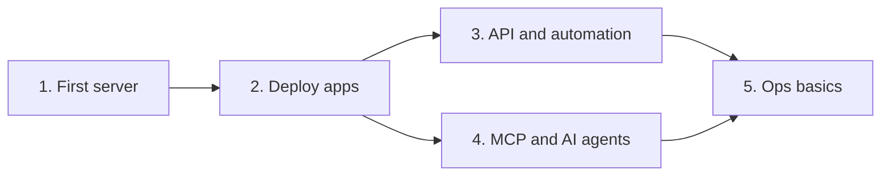

<h1 align="center">☁️ Cloudways Cookbook</h1>

<p align="center"><b>Launch, deploy, and automate on Cloudways in an afternoon.</b><br>
A hands-on guide for hackers: Git deploys, the v2 API, and AI-agent control over MCP.</p>

<p align="center">
  
  
  
  
</p>


A hands-on collection of guides and runnable examples for hackers getting started with [Cloudways](https://www.cloudways.com): managed cloud hosting on top of DigitalOcean, Vultr, Linode, AWS, and Google Cloud.

> **Disclaimer:** This is an unofficial, community-style guide, fact-checked against Cloudways docs on **October 21, 2026**. Cloudways ships changes often (the API, MCP server, and auth model all changed in 2026). Always confirm details in the [official docs](https://support.cloudways.com) and the [API Playground](https://developers.cloudways.com/play). Anything marked **(verify)** was read from docs but not tested against a live account.

## Who this is for

Developers who are comfortable with a terminal and Git but new to Cloudways. You'll go from zero to a deployed app, then automate it with the API and drive it from an AI agent over MCP.

## Learning path



## Repository structure

- [**Tutorials**](tutorials): Step-by-step guides, numbered in the order to read them.
- [**Scripts**](scripts): Dependency-free Python helpers for the Cloudways API (`cw.py` plus small CLI tools).
- [**Notebooks**](notebooks): A Jupyter quickstart for exploring the API interactively.
- [**GUIDE.md**](GUIDE.md): Everything above in one long file.
- [**index.html**](index.html): The same guide as a polished, self-contained web page (dark mode, copy buttons). Host it anywhere, e.g. GitHub Pages.
- [**tools/build.py**](tools/build.py): Regenerates `GUIDE.md` and `index.html` from the tutorials.

## Get started

| # | Tutorial | You will |
|---|----------|----------|
| 1 | [First server and app](tutorials/01-first-server/README.md) | Start the free trial, launch a server, reach it over SSH/SFTP |
| 2 | [Deploy apps](tutorials/02-deploy-apps/README.md) | Ship WordPress, PHP/Laravel, and Git-based deployments |
| 3 | [API and automation](tutorials/03-api-and-automation/README.md) | Create an Access Token, call the v2 API, script your fleet |
| 4 | [MCP and AI agents](tutorials/04-mcp-ai-agents/README.md) | Manage Cloudways from Claude, Cursor, VS Code, and more |
| 5 | [Ops basics](tutorials/05-ops-basics/README.md) | Domains, SSL, backups, staging, monitoring, scaling |

**Fastest path for a hackathon:** do tutorial 1, then tutorial 3 or 4. You can have a server provisioned and scripted in well under an hour, minus provisioning wait time.

## Before you begin: three things that changed in 2026

1. **Legacy API keys are going away.** The email + API key flow was scheduled for end of life on **October 15, 2026** (already passed), after which keys are revoked. New accounts only get **Access Tokens**. Use `Authorization: Bearer <token>`.
2. **API v1 is sunset, v2 is current.** The v2 base URL is `https://api.cloudways.com/api/v2`. Cloudways says migration is mostly replacing `v1` with `v2` in URL paths. Some older help articles still show v1 code samples.
3. **API access is owner-only.** Team members can't create tokens; the primary account owner must.

## Quick API smoke test

```bash
export CLOUDWAYS_TOKEN="<your access token>"
python3 scripts/list_servers.py
```

## Additional resources

- [Cloudways Help Center](https://support.cloudways.com)
- [API docs](https://developers.cloudways.com/docs) and [API Playground](https://developers.cloudways.com/play)
- [Access Token guide](https://support.cloudways.com/en/articles/5136065-how-to-create-and-manage-cloudways-api-access-tokens)
- [MCP server setup](https://support.cloudways.com/en/articles/14654372-how-to-use-cloudways-mcp-server-for-ai-based-server-management) and [MCP tool reference](https://support.cloudways.com/en/articles/15798823-cloudways-mcp-server-tools)
- [Node.js templates on GitHub](https://github.com/CloudwaysbyDO/)
- [Cloudways on Reddit](https://www.reddit.com/r/CloudwaysbyDO/)

## Get help

Ask in the Cloudways community, or contact support 24/7 through the platform's chat. For issues with this cookbook, open an issue in this repository.

## Contributing

Corrections are welcome, especially anything marked **(verify)** that you've confirmed. Keep examples runnable and keep secrets out of commits. After editing a tutorial, run `pip install markdown && python3 tools/build.py` to refresh `GUIDE.md` and `index.html`.

## Safety notes for hackers

- Servers bill by the hour once you leave the trial. Delete what you don't need.
- The API Playground and every script here act on your **real account**. Use a throwaway server.
- Never commit tokens. Use environment variables or a secrets manager.
